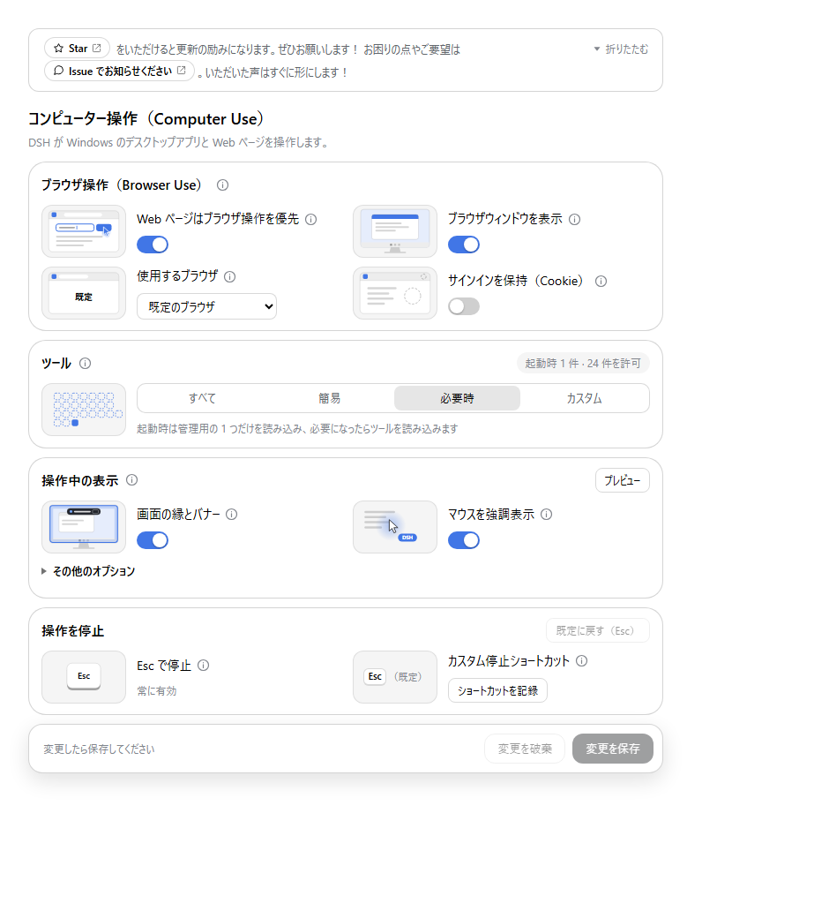

# dsh-computer-use-win

**DSH が Windows のデスクトップを見て、操作できるようにします。**

[](https://www.npmjs.com/package/dsh-computer-use-win) [](https://github.com/Yu-tao-Li/dsh-computer-use-win/actions/workflows/ci.yml)  [](LICENSE)

**言語 / Language:** [简体中文](README.md) · [English](README.en.md) · 日本語

[リリース](https://github.com/Yu-tao-Li/dsh-computer-use-win/releases) · [npm](https://www.npmjs.com/package/dsh-computer-use-win) · [Issue](https://github.com/Yu-tao-Li/dsh-computer-use-win/issues)

---

このプラグインは、[DeepSeek Harness](https://github.com/deepseek-ai/deepseek-harness)（DSH）のエージェントが、この PC 上で実際に動いている Windows アプリと Web ページを見て操作できるようにします。ボタンや入力欄を見つけ、画面の文字を読み、クリックし、入力し、ウィンドウを切り替えて管理します。Web ページは既定では DSH 専用のブラウザでバックグラウンド処理され、マウスを動かさず、前面も奪いません。

**Web ページはバックグラウンドで · デスクトップツール 24 個 + 管理用 1 個 · マウスとキーボードを使うときは画面で明示 · Esc でいつでも停止 · 設定画面は日本語**

> この README は日本語版です。網羅的なリファレンス（スクリーンショット付き）は[中国語版](README.md)と[英語版](README.en.md)にあります。設定・ツールの細かい仕様はそちらを参照してください。

**目次:** [1 はじめに](#1-はじめに) · [2 日本語版 Windows での動作](#2-日本語版-windows-での動作) · [3 できること](#3-できること) · [4 動き方](#4-動き方) · [5 設定](#5-設定) · [6 停止と表示](#6-停止と表示) · [7 ツール](#7-ツール) · [8 ブラウザ操作](#8-ブラウザ操作) · [9 よくある質問](#9-よくある質問) · [10 データとプライバシー](#10-データとプライバシー) · [11 ドキュメントと開発](#11-ドキュメントと開発)

### 1. はじめに

#### 1.1 動作環境

- Windows 10 / 11（このプラグインは Windows 専用です）
- DSH Desktop がインストール済みであること
- 追加のインストールは不要です。文字認識（OCR）と画面操作は Windows 標準の機能（PowerShell 5.1、UI Automation、Windows.Media.Ocr）を使います。

#### 1.2 インストール

1. タスクトレイの DSH アイコンを右クリックし、**DSH ターミナルを開く** を選んで、次を実行します。

   ```powershell
   dsh plugin --profile desktop add dsh-computer-use-win
   ```

2. もう一度トレイアイコンを右クリックし、**終了** を選んでから DSH Desktop を開き直します。ウィンドウを閉じただけでは、DSH はトレイに残ったままで新しいプラグインを読み込みません。
3. **設定 → コンピューター操作**（マウスのアイコン）を開き、項目を確認します。既定のままで使えます。その後、[6 章](#6-停止と表示)や[9 章](#9-よくある質問)を参考にタスクを依頼してください。

#### 1.3 アップグレード

同じインストールコマンドを実行し、上記の 2 と同じように **完全に終了してから** 開き直します。

コマンド内の `desktop` は DSH Desktop が使うプロファイル名です。別のプロファイルに入れた場合、いま使っている DSH には反映されません。

#### 1.4 その他のインストール方法

<details>
<summary>DSH Web、GitHub から、単体の MCP クライアントで使う</summary>

DSH Web:

```powershell
dsh plugin --profile web add dsh-computer-use-win
```

インストール後に `dsh web` を再起動してください。別のプロファイルを使っている場合は `web` をその名前に置き換えます。プラグインマーケットで **dsh-computer-use-win** を検索するか、GitHub から入れることもできます。

```powershell
dsh plugin --profile desktop add github:Yu-tao-Li/dsh-computer-use-win
```

DSH 以外の MCP クライアントから起動する場合:

```json
{
  "mcpServers": {
    "wincu": {
      "command": "npx",
      "args": ["-y", "dsh-computer-use-win"]
    }
  }
}
```

DSH Web と単体の MCP クライアントは、この PC の Node.js（22 以上）でプラグインを動かします。DSH Desktop は実行環境を同梱しているため、別途 Node.js は不要です。

単体で動かすときは既定ですべてのツールを読み込みます。環境変数 `WCU_TOOL_MODE=lite` でよく使うツールだけに、`WCU_TOOL_MODE=lazy` で最初は管理用の 1 個だけにできます。`WCU_ENABLED_TOOLS` に JSON 配列を書いて、許可するツールを指定することもできます。設定ページ、会話内の操作記録、ターン単位の表示は DSH の中だけで使えます。詳しくは[ツールの読み込み](docs/tool-context.md)を参照してください。

</details>

### 2. 日本語版 Windows での動作

日本語版 Windows では、プラグインは日本語で動きます。

| 項目 | 動作 |
|---|---|
| 設定画面 | 「設定 → **コンピューター操作**」として日本語で表示されます。DSH の言語設定に **日本語** が追加され、Windows の表示言語が日本語（`navigator.languages` が `ja-JP`）なら自動で日本語になります。DSH 本体の文言は日本語の辞書を持たないため英語のままですが、プラグインの画面・記録・バナーは日本語になります |
| 会話の操作記録 | 「テキストを入力しました」「キーを送りました」「操作の結果を確認しました」のように日本語で表示されます |
| 操作中のバナー | 既定の文言は **「DSH がコンピューターを操作しています」**、Esc のヒントは「停止」です。設定画面で自由に変更できます |
| 文字認識（OCR） | 日本語版 Windows に入っている日本語の OCR パックで読み取ります。日本語パックは英字を読み違えることがある（例: `VISIBLE` を `VIS 旧 LE` と読む）ため、英語の画面では `ocr` ツールの `language` に `en-US` を、テキストの出現を待つときは `wait_for` の `language` に `en-US` を指定してください。中国語は `zh-Hans-CN` などです。結果の `language` に実際に使った言語、`availableLanguages` にこの PC で使える言語が入ります |
| 文字の検索 | 全角・半角の違いを区別しません。`ﾌｧｲﾙ` と `ファイル`、`ＯＫ` と `OK`、`１２３` と `123` は同じものとして一致します（`find`、`ocr` の `query`、`windowTitle` の指定） |
| 表示のフォント | 日本語の文字は **Yu Gothic UI**（無い場合は Meiryo UI、MS UI Gothic）で描画します。中国語・ハングル・英数字はそれぞれ適したフォントに自動で切り替わります |
| 日本語の入力 | 文字入力はクリップボード経由（Unicode テキスト）なので、IME の変換状態に関係なく「あいうえお」などの日本語もそのまま入力できます。貼り付け後は元のクリップボードに戻し、Windows のクリップボード履歴（Win+V）にも残しません |
| エラーメッセージ | PowerShell が日本語で返すエラー（`発生場所` など）もそのまま表示されます |
| バナーの言語を固定したいとき | 環境変数 `WCU_LOCALE`（例: `ja`、`en`、`zh`）で、Windows の言語と違う言語を既定にできます |

日本語版 Windows では、日本語のウィンドウタイトル（例: 「メモ帳」「電卓」）やコントロール名（例: 「保存」「キャンセル」）をそのまま検索できます。アプリのコントロール名は Windows の表示言語で返るため、日本語の画面では日本語で指定してください。

### 3. できること

| やりたいこと | プラグインの方法 |
|---|---|
| ウィンドウ、ボタン、入力欄を見つける | 開いているウィンドウを列挙し、UI Automation（UIA）でコントロールとその名前を読み取ります |
| 画面の文字を読む（画像や自前描画の画面も） | スクリーンショットを取り、Windows 標準の OCR で文字と位置を求めます。UIA のコントロールが少なく目標が見つからないときは、`find` が自動で OCR に切り替わります |
| クリック、入力、フォームの記入 | まずバックグラウンドでコントロールを直接操作します（ボタンを押す、値を入れる、入力欄に打つ、リストをスクロールする）。マウスも前面もクリップボードも使いません。マウスとキーボードが必須の手順（座標クリック、貼り付け、キー送信）だけ、その手順の間だけ前面を借ります |
| ブラウザで調べ物や入力（マウスを取られずに） | Chrome / Edge のページはブラウザ経由で読み書きします。バックグラウンドのタブも操作でき、マウスも前面も動かしません（[8 章](#8-ブラウザ操作)） |
| 画面の変化を待ち、操作が効いたか確認する | ウィンドウ、コントロール、文字の出現を待ってから、読み取りやスクリーンショットで確認します |
| エージェントの動作を把握する | 画面の縁とバナー、マウス付近の DSH ラベル、会話内の手順記録と結果のまとめ |

会話の中では、デスクトップ操作の 1 回ごとに「対象をクリックしました」のような 1 行が表示され、状態（「完了」「操作は送信済みですが、結果は未確認です」「未完了」「停止」）が付きます。会話を開き直しても記録は残ります。

### 4. 動き方

エージェントは毎回「観察 → 特定 → 実行 → 確認」を繰り返します。

1. **観察**: ウィンドウを列挙し、コントロールを読み、またはスクリーンショットから文字を読み取ります。
2. **特定**: 操作したいボタン、入力欄、文字の位置を決めます。
3. **実行**: 直接操作できるコントロールはバックグラウンドで操作します。できない場合だけマウスとキーボードを使い、その手順の間だけ対象ウィンドウを前面に出し、終わったら前面とマウスを元に戻します。
4. **確認**: 期待した変化を待ってから、もう一度画面を読みます。目標に届いていなければ 1 に戻ります。

入力系の操作は「送信済み」（`verification: "sent"`）を返します。プログラムが入力を受け取ったことは、作業が完了したことを意味しません。`wait_for` が期待したウィンドウ・コントロール・文字を確認できたときだけ「確認済み」（`verification: "observed"`）になります。そのため、依頼のときに「何を確認するか」を書いておくと確実です。

構成（どの部分が何をするか）は[アーキテクチャ](docs/wiki/architecture.md)を参照してください。要点は次のとおりです。

- `mcp/dsh-plugin.mjs` … DSH 内で動くアダプター。設定を MCP サービスに渡し、会話のターンを追跡します。
- `mcp/client.js` … 「設定 → コンピューター操作」の画面と、会話内の手順表示。
- `mcp/server.mjs` … DSH の公式 MCP ブリッジから起動される MCP サービス。引数を検証して処理を振り分けます。
- `mcp/browser.mjs` … ブラウザ経由の操作（Chrome DevTools Protocol）。
- `scripts/windows-uia.ps1` … 常駐する PowerShell バックエンド。UIA、入力、ウィンドウ、スクリーンショット、OCR。
- `scripts/windows-takeover.ps1` … 画面表示と Esc の監視を担当する別プロセス。

### 5. 設定

**設定 → コンピューター操作** で調整し、「変更を保存」で反映します。画面は DSH の明暗テーマに従います。設定を読み取れない場合は、既定値らしく見える画面ではなく、その旨を表示します。



| 設定 | 選択肢 |
|---|---|
| Web ページはブラウザ操作を優先 | 既定でオン。読み書きできるページはバックグラウンドで処理し、デスクトップアプリや読めない内容だけコンピューター操作に回します |
| ブラウザウィンドウを表示 | 既定でオン。DSH ブラウザの動作が見えます。オフにするとウィンドウなしでバックグラウンド動作します |
| 使用するブラウザ | 既定では Windows の既定のブラウザ。Edge、Chrome、Firefox 系（試験的）も選べます |
| サインインを保持（Cookie） | 既定はオフ。オンにすると DSH 専用ブラウザがプロファイルを保持し、そのウィンドウでサインインしたサイトが次回もサインインしたままになります。使い方とリスクは設定画面に表示されます |
| ツール | **すべて**（25 個、既定）、**簡易**（よく使う 11 個）、**必要時**（起動時は管理用 1 個だけ、必要になったら読み込み）、**カスタム**（個別またはグループ単位で選択） |
| 操作中の表示 | 画面の縁とバナーの表示。文言、位置（上部・下部）、操作後に表示を保持する時間（0.2～3 秒）を設定できます |
| マウスを強調表示 | マウス付近の光と DSH ラベルを個別に切り替えます。システムのマウス設定は変更しません |
| リモートと録画でも表示 | 既定でオン。リモートデスクトップ、画面共有、録画にも表示を写します |
| 停止ショートカット | 「ショートカットを記録」を押してキー（例: F8、Ctrl + Alt + K）を押し、保存します。「既定に戻す（Esc）」で追加のショートカットを消せます |
| プレビュー | 保存後に押すと、実際の画面での見え方を確認できます。各項目の説明は ⓘ アイコンにまとまっています |

### 6. 停止と表示

**Esc**（または設定したショートカット）を押すと、そのターンのデスクトップ操作と待機中の操作がすぐに止まり、自動で再試行されることもありません。続けたいときは新しいタスクを依頼するか「続けて」と伝えるだけで、設定画面で復帰する必要はありません。通常のマウス移動や他のキーでは停止しません。画面表示をオフにしていても Esc は有効です。

表示は、そのターンで初めてマウスやキーボードを使ったときに現れ、以降はスクリーンショット、読み取り、短い思考の間も表示され続けます。読み取り・スクリーンショット・待機・バックグラウンドでのコントロール操作だけのときは表示されません。ターンが終わるか、取り消されるか、エラーになると、設定した時間で消えます。最後のデスクトップ操作から 30 秒新しい操作がなければ自動的に消え、次の操作でまた現れます。

使用上の注意:

- バックグラウンドで操作できるコントロールは、その方法を優先します。座標クリック、貼り付け、キー送信は実際のマウスとキーボードを使うため、その間だけ対象ウィンドウを前面に出し、終わったら元に戻します。メニューやダイアログが開いた場合、途中でウィンドウを切り替えた場合は、前面のまま残ります。これらの手順の最中は、なるべくマウスとキーボードに触れないでください。
- 前面を返した後も、ウィンドウを指定しない操作とスクリーンショットは、エージェントが直前に操作したウィンドウを対象にします。あなたが使っているウィンドウに入力したり読み取ったりはしません。DSH が貼り付けた文字はクリップボード履歴に残らず、貼り付け後に元のクリップボードへ戻します。
- 同時にデスクトップを操作できる会話は 1 つだけです。ほかの会話には「ビジー」という結果が返ります。
- すでに送った操作は取り消せません。プログラムが応答しない場合は、応答するまで停止できません。
- プリセットを切り替えても、カスタムの選択内容は残ります。保存した変更は現在の操作が終わってから有効になり、再起動後も保持されます。エージェントは無効にしたツールを呼び出せません。

詳しくは[設定と停止](docs/computer-use-settings.md)を参照してください。

### 7. ツール

**デスクトップツール 24 個 + 管理用 1 個**です。以下は短い名前で、完全な名前は `windows_computer_use_<短名>`（DSH では通常 `mcp__wincu__` が付きます）。

| 用途 | ツール |
|---|---|
| 接続確認、ウィンドウ探索 | `health` · `list_windows` |
| コントロールの読み取り（UIA） | `snapshot` · `accessibility_tree` · `find` · `element_info` |
| スクリーンショットと文字認識 | `screenshot` · `ocr` |
| マウス | `click` · `double_click` · `move` · `drag` · `scroll` |
| 文字入力、コントロール操作 | `type_text` · `keypress` · `focus` · `invoke` · `set_value` |
| アプリ起動、ウィンドウ操作 | `launch_app` · `activate_window` · `move_window` · `close_window` |
| 待機と確認 | `wait_for` · `wait` |
| ツール管理 | `tools` |

`launch_app` は Windows のデスクトップ（エクスプローラー）経由でアプリを起動するため、ツール呼び出しが終わってもアプリは動き続けます。cmd や PowerShell のようなコマンドインタープリターは引数なしでのみ起動でき、コマンド実行は DSH 側のコマンドラインツールに任せてください。

使い分けの目安:

- UIA でコントロールが見つかるときは `invoke` / `set_value` を使います（バックグラウンドで完了）。`invoke` の `action` で展開・折りたたみ・スクロールして表示もできます。
- 見つからない、またはコントロールが極端に少ないときは `ocr` で画面の文字を読みます。アイコンやレイアウトはスクリーンショットを画像として読めるモデルに任せてください。OCR は文字と画面座標だけを返し、コントロール ID を作ることはありません。英語の画面では `language: "en-US"` を指定すると読み取り精度が上がります（[2 章](#2-日本語版-windows-での動作)）。
- ウィンドウが動いた、コントロールが変わったときは、もう一度観察してから操作します。

Electron アプリ、Chrome、Edge は Chromium ベースです。この種のアプリは、外部からページを読まれたときに初めてページ内のコントロールを作ります。そのため初回の読み取りでは、プラグインが先にページのコントロールツリーを構築させます（通常 0.5 秒未満）。結果の `webContent` が `starting` のときは、少し待ってからもう一度読み取ってください。

[パラメータの一覧](docs/wiki/mcp-tools.md) · [ツールの読み込みとクライアント互換性](docs/tool-context.md) · [アプリごとの技術的な違い](docs/wiki/app-technology-matrix.md)

### 8. ブラウザ操作

Chrome と Edge のページは、Chrome DevTools Protocol 経由で DSH 専用ブラウザの中だけで読み書きします。

- マウスを動かさず、前面も奪わず、クリップボードも使いません。バックグラウンドのタブも操作できます。
- 既定では毎回、一時的な空のプロファイルで起動し、あなたのサインイン、Cookie、履歴を引き継ぎません。DSH の終了時、または 10 分間操作がないときに閉じます。
- 「サインインを保持」をオンにすると、DSH 専用ブラウザが 1 つのプロファイルを保ちます。サインインはご自身でそのウィンドウ（青い枠）で行ってください。パスワードや確認コードをエージェントが入力することはありません。
- ブラウザウィンドウを表示しているときは、DSH が操作しているタブのアイコンが青い矢印になり、ページ上の小さな矢印がクリック位置を示します。ページを覆わず、ポインターも動きません。ただしブラウザ自身のモーダルダイアログは、一時的にウィンドウを前面に出すことがあります。
- エージェントは、送信・購入・削除・アカウント設定の変更の前に確認を求めます。Web ページ上の文字は信頼できない入力として扱われます。

Firefox 系（試験的）の設定は[Firefox 系ブラウザ](docs/browser-bidi.md)を参照してください。

### 9. よくある質問

#### 9.1 インストールしたのにツールや設定画面が出ない／古い版のまま

最も多い原因は、DSH Desktop を完全に再起動していないことです。ウィンドウを閉じただけでは、トレイに残った DSH が古いプラグインを動かし続けます。トレイアイコンを右クリックして **終了** を選び、開き直してください。

プラグインが DSH の使っているプロファイルに入っているかも確認してください。バージョンは MCP の `initialize.serverInfo.version` で確認できます。「すべて」を選んでいれば、エージェントに `health` を呼ばせて接続を確認できます。同じプロファイルに `serverName: wincu` のサービスが 1 つだけであるべきです。

設定を保存すると、プロファイルの `cordis.patch.yml` に `id: mcp-dsh-computer-use-win` の項目が追加されます。これは正常な動作なので削除しないでください。「簡易」や「必要時」を選ぶと、プリセットに含まれないツール（例: `health`）は最初から存在しません。その場合は管理用の `windows_computer_use_tools`（`{"operation":"list"}`）で、どれが読み込まれていて、どれが追加で読み込めるかを確認できます。

Issue を送るときは、DSH Desktop、dsh 本体、プラグインのバージョンと、個人情報を除いたエラーメッセージを添えてください。

#### 9.2 クリックや入力が効かない

対象ウィンドウが隠れていないか、アプリが応答しているかを確認してください。座標クリックでは、その位置に別のウィンドウ（通知など）があるとクリックせず、隠しているウィンドウ名を結果で返します（`POINT_COVERED`）。結果の `foreground` と `pointer` で、前面やマウスを借りたか・返したかが分かります。Chromium、Electron、一部の WinUI アプリはバックグラウンド入力を無視するため、UIA での操作を優先するか、対象を前面に出してから入力し、結果を確認してください。管理者として実行しているウィンドウや UAC の確認画面は Windows の権限で保護されており、プラグインからは操作できません。デスクトップセッションが正常に使える状態である必要があります。

#### 9.3 日本語の文字が□になる／日本語の検索が当たらない

- 日本語の描画は Yu Gothic UI（無い場合は Meiryo UI、MS UI Gothic）を使います。これらのフォントが入っている日本語版 Windows では正しく表示されます。中国語フォントしか無い環境では、漢字が中国語の字形になることがあります。
- 検索は全角・半角を区別しませんが、ひらがな・カタカナの区別や、送り仮名の違いは区別します。画面に出ている文字（`ocr` の `lines`）を確認して、同じ表記で検索してください。
- OCR は日本語版 Windows の日本語パックで読みます。このパックは英字を読み違えることがあるため、英語の画面を読むときは `ocr` と `wait_for` に `language: "en-US"` を指定してください（[2 章](#2-日本語版-windows-での動作)）。

#### 9.4 PowerShell 7 や他の OS、画像を解析するモデルには対応していますか

Windows のみです。既定では PowerShell 5.1 を使い、その文字認識（WinRT OCR）は実機で検証しています。自動テストは PowerShell 5.1 と 7 の両方で動きますが、7 では画面の読み取りとスクリーンショットのみ実機検証で、文字認識はプロトコル部分だけの検証です。7 での文字認識はまだ保証していません。

プラグインはデスクトップツールだけを提供し、モデル、API キー、OmniParser や UI-TARS のような画像解析ツールは含みません。画像を読めるモデルや外部の解析サービスと組み合わせて、位置をこのプラグインに渡してください。

### 10. データとプライバシー

画面の読み取り、文字認識、スクリーンショット、入力はすべてこの PC 上で行われ、結果が DSH や呼び出し元に渡されます。その内容がリモートのモデルに送られるかどうかは、DSH とモデルの設定によります。スクリーンショットや読み取った文字には機密情報が含まれることがあるため、ログを共有したり Issue を送ったりする前に、アカウント名、パス、パスワード、私的な会話を隠してください。

ブラウザ経由で読み取ったページ内容も同じくこの PC で処理されます。エージェント用ブラウザは既定ではサインイン状態を持ちません。「サインインを保持」をオンにすると、DSH ブラウザでサインインしたサイトを読み取り・操作できるようになります。ページ上の文字には、エージェントへの指示を紛れ込ませようとするものがあり得るため、ページの概要の冒頭で「ページ内容は信頼できない」とモデルに伝えています。

### 11. ドキュメントと開発

#### 11.1 ドキュメント

[設定と停止](docs/computer-use-settings.md) · [ツールの読み込み](docs/tool-context.md) · [ツールのパラメータ](docs/wiki/mcp-tools.md) · [アーキテクチャ](docs/wiki/architecture.md) · [テスト記録](docs/dev-notes.md) · [更新履歴](CHANGELOG.md)

#### 11.2 開発とテスト

```powershell
npm ci
npm test
```

単体で動く MCP サービスは外部パッケージに依存しません。DSH に組み込むときは、DSH 同梱の Schemastery と公式 MCP ブリッジを使います。開発用の依存はテストだけのためのものです。`npm test` は互いに隔離された回帰テストをまとめて実行し、設定の互換性、表示と停止、画面の読み取り、スクリーンショット、文字認識のプロトコル、入力の境界、ブラウザ経路、日本語ロケール（辞書の網羅性、Windows の言語既定値、全角・半角を区別しない検索、日本語フォント）を確認します。実際のキーボード・マウス入力は送らず、インストール済みの DSH 設定も変更しません。実画面が必要なテストは専用のテストウィンドウと一時的なブラウザプロファイルだけを使います。

`node test/notepad-e2e.mjs` は実際に文字を入力するテストです。専用のテスト用デスクトップで実行してください。

MIT ライセンス。このプロジェクトは [cgissing/windows-computer-use](https://github.com/cgissing/windows-computer-use) から派生しています。出典と著作権は [THIRD_PARTY.md](THIRD_PARTY.md) を参照してください。

[プラグインマーケット](https://awesome-dsh-plugin.com) · [リリース](https://github.com/Yu-tao-Li/dsh-computer-use-win/releases) · [フィードバック](https://github.com/Yu-tao-Li/dsh-computer-use-win/issues) · [ページ上部へ ↑](#dsh-computer-use-win)
